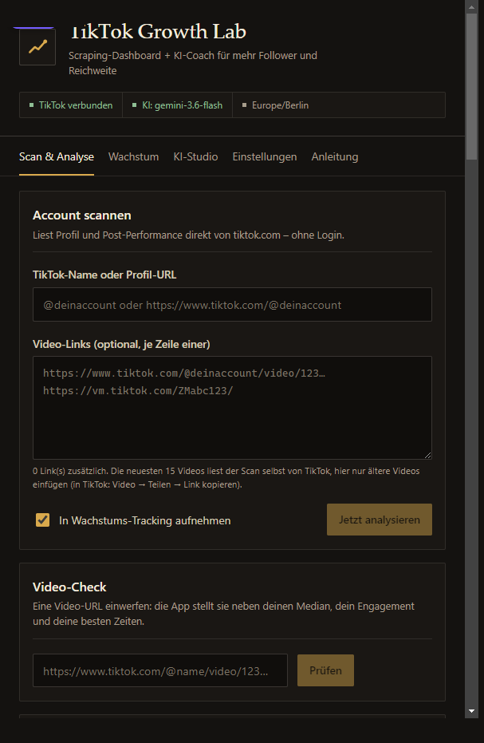
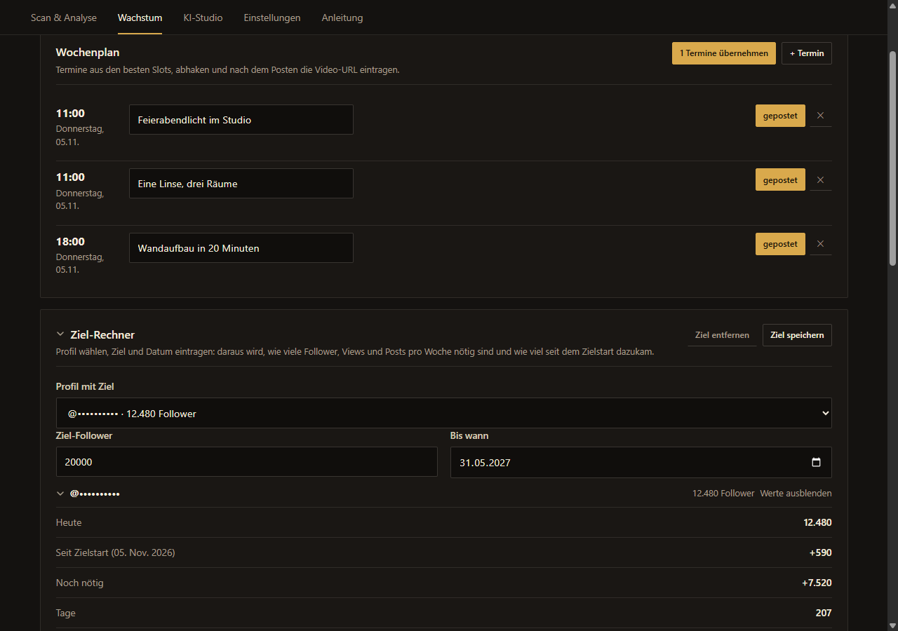
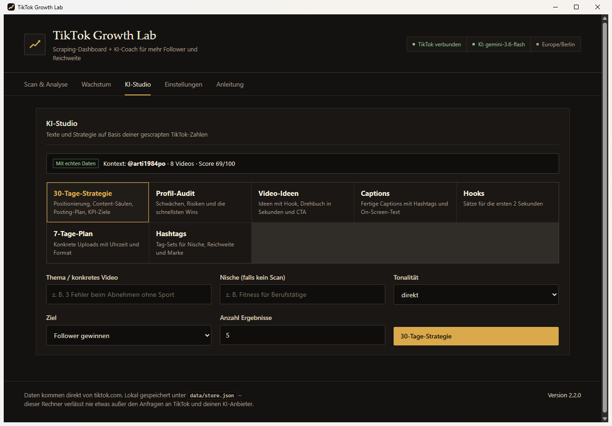
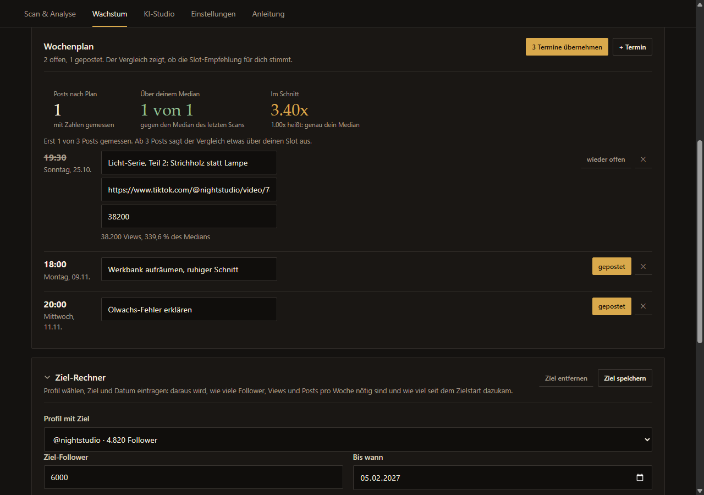
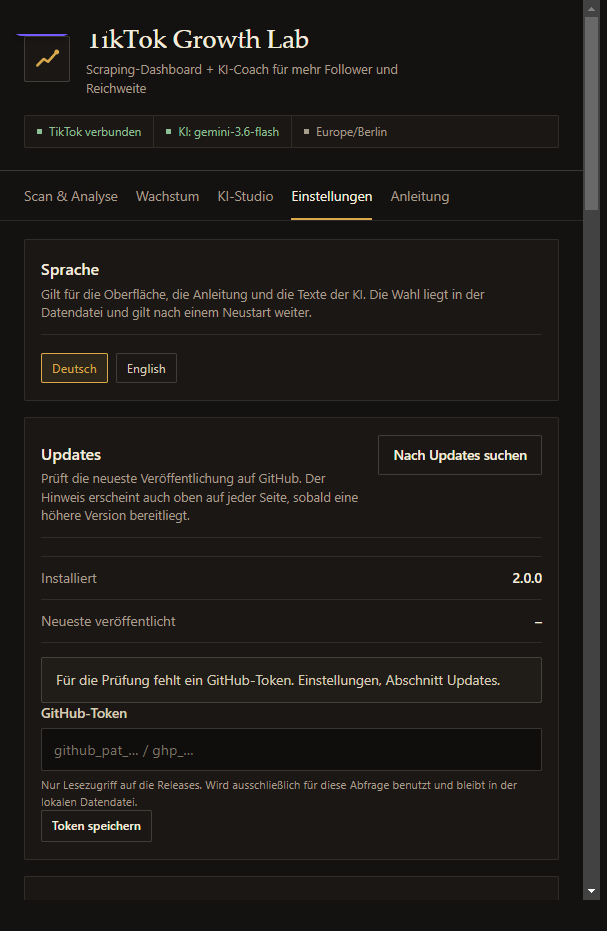
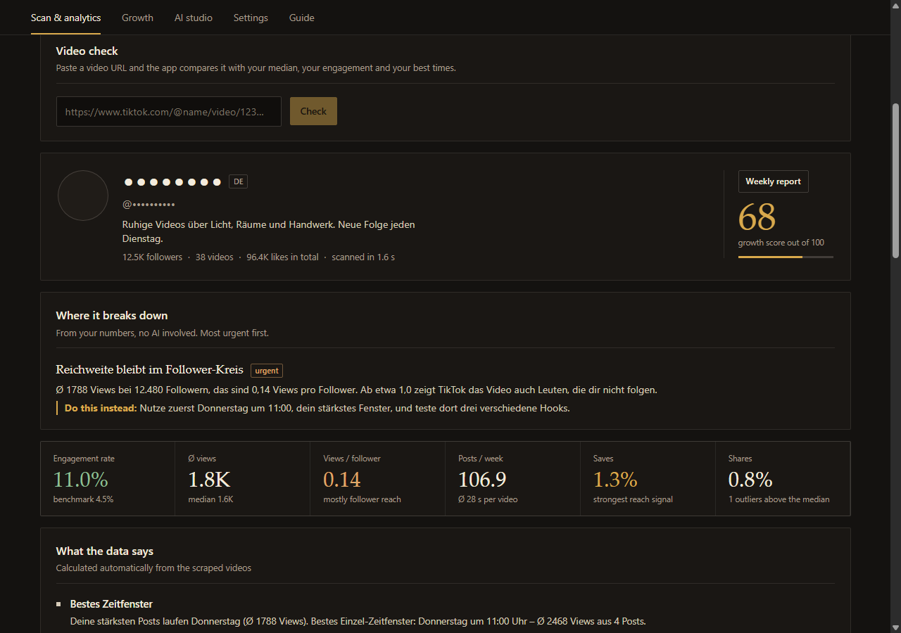
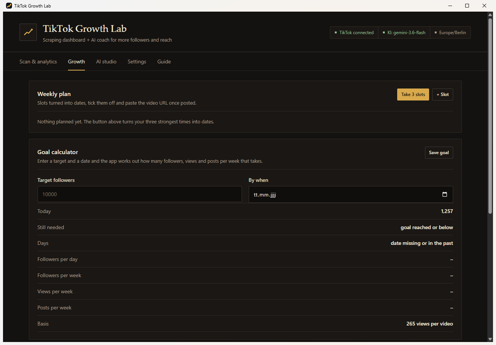
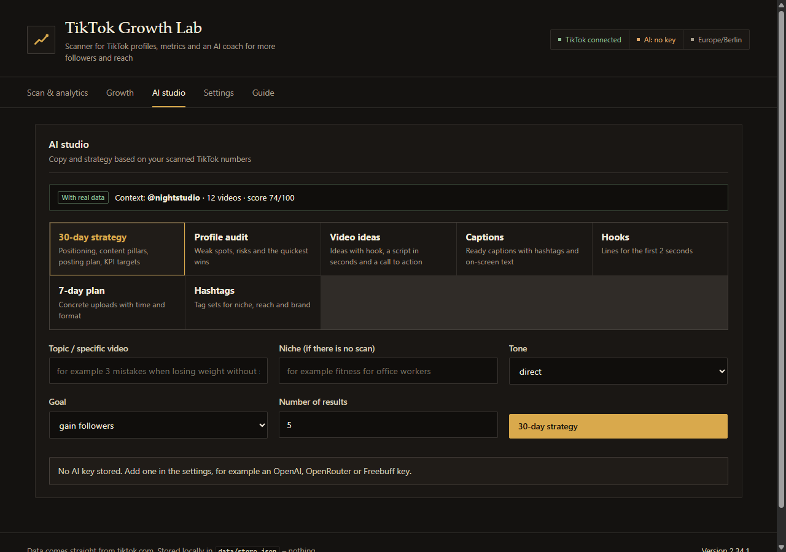
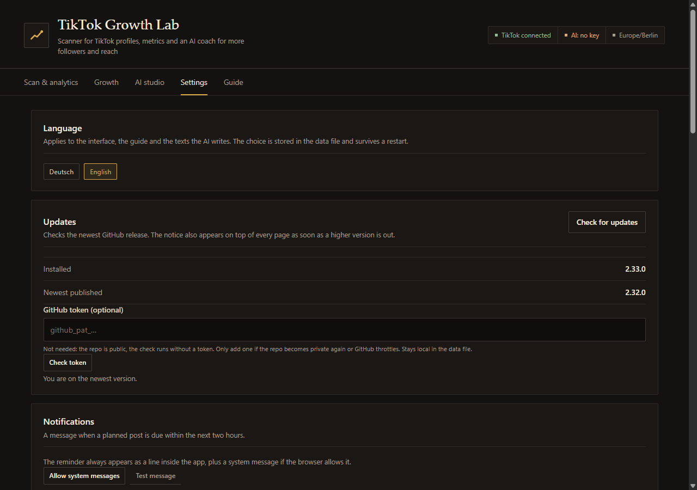

# TikTok Growth Lab

**Deutsch** · [English](#english)

Lokales Programm für TikTok-Wachstum: liest Profil und Video-Performance direkt von tiktok.com, rechnet daraus
Engagement, beste Posting-Zeiten und Ausreißer und lässt eine KI Strategie, Hooks, Captions und einen Wochenplan
daraus schreiben. Alles läuft auf dem eigenen Rechner, ohne Konto und ohne Cloud.

| | |
|---|---|
| Windows | `TikTok-Growth-Lab.exe`, portabel, kein Installer |
| Web | lokaler Server, `npm start`, dann <http://localhost:8787> |
| Sprachen | Deutsch und Englisch, umschaltbar in den Einstellungen |
| Daten | nur lokal in `data/store.json` |

## Was es kann

### Scan und Analyse
Profil und die neuesten 15 Videos werden beim Scan von tiktok.com gelesen: Views, Likes, Kommentare, Shares, Saves,
Länge, Sound, Hashtags und Uhrzeit. Daraus entstehen Engagement-Rate, Views pro Follower, Median, Posting-Rhythmus,
ein Growth-Score von 0 bis 100, die besten Zeitfenster und automatisch formulierte Empfehlungen.

Ein Feld reicht: Link oder Name des Profils eintragen, "Schwächen prüfen" starten, alternativ Strg + Enter. Unter dem
Feld stehen die zuletzt gescannten und die getrackten Konten als Schnellwahl, das × daneben entfernt einen Namen. Die
letzten fünf Scans bleiben gespeichert, ein Neustart verliert die Analyse also nicht. Direkt unter dem Profil steht die
Karte "Wo es hakt": Interaktion, Reichweite, Rhythmus, Originalton und eine zu dünne Datenbasis, dringende Punkte
zuerst. Jeder Punkt nennt die Zahl dahinter und unter "Besser machen" den konkreten nächsten Schritt. Das rechnet
der Server aus den gescannten Zahlen, ohne KI.



### Video-Check
Eine einzelne Video-URL einwerfen und das Video gegen den eigenen Median, das eigene Engagement, die Längenfenster
und die besten Zeiten stellen. Beantwortet die Frage, warum ein Video lief und ein anderes nicht.

### Wochenplan und Ziel-Rechner
Der Scan liefert die starken Zeiten, der Wochenplan macht daraus echte Termine mit Idee, Status und Video-URL. Nach
dem Posten steht die Zahl neben dem Termin, die App misst erledigte Termine bei jedem Scan selbst nach. Ab drei
gemessenen Posts steht darüber die Trefferquote: wie viele Termine über dem Median lagen, wie viel Median sie im
Schnitt erreichten und ob der geplante Slot besser lief als ein verschobener Post. Dieselben Zahlen bekommt die KI
als belegten Kontext, damit ihre Empfehlung auf deinen Ergebnissen steht statt auf einer Annahme. Der Ziel-Rechner
hängt an einem Profil: er sagt, wie viele Follower, Views und Posts pro Woche für ein Ziel nötig sind, und zeigt
daneben, wie viele Follower seit dem Zielstart dazugekommen sind.



### KI-Studio
Sieben Werkmappen: 30-Tage-Strategie, Profil-Audit, Video-Ideen, Captions, Hooks, 7-Tage-Plan und Hashtags. Die KI
arbeitet mit den gescannten Zahlen, nicht mit Allgemeinplätzen. Jeder OpenAI-kompatible Anbieter geht, kostenlos
starten Gemini, Groq oder OpenRouter mit eigenem Key.



Der 7-Tage-Plan liest sich als Ablauf statt als JSON: Tag, Uhrzeit, Thema, Hook, Format, Sound,
Call-to-Action, Aufwand und Hashtags.



### Wachstums-Tracking
Accounts in eine Watchlist legen, jeder Scan und jede Messung erzeugt einen Punkt im Verlauf. Sinnvoll, weil TikTok
selbst keine Follower-Historie herausgibt: die Kurve entsteht aus den eigenen Messungen.

### Wochenbericht
Die wichtigsten Zahlen, die besten Videos und die Empfehlungen in einem Blatt, das sich als Text in die
Zwischenablage kopieren lässt.

### Datensicherung
"Daten exportieren" in den Einstellungen schreibt Konten, Messpunkte, Wochenplan, Ziele und die letzten Scans als
JSON-Datei. API-Key, TikTok-Cookie und GitHub-Token sind nicht enthalten. "Sicherung einlesen" ersetzt diese Bereiche
nach einer Rückfrage, der bisherige Stand bleibt als `store.json.bak` liegen. Bei jedem Speichern legt die App ohnehin
eine Sicherung an; ist die Datendatei unlesbar, lädt sie die Sicherung und legt die kaputte Datei mit Zeitstempel
daneben. In der Desktop-App liegt der API-Key verschlüsselt in `secrets.dat`, nicht in der Datendatei.

### Sprache, Updates, Erinnerung
Deutsch und Englisch für Oberfläche, Anleitung, Zahlenformate und KI-Texte. Neue Versionen lädt die Windows-App im
Hintergrund selbst herunter (gegen die GitHub-Releases, ohne Einrichtung), die alte Datei wird beim Beenden ersetzt:
danach genügt ein Neustart. Geplante Posts erscheinen als Leiste und
als Systemmeldung, sobald sie in den nächsten zwei Stunden fällig sind.



## Installieren

**Windows:** `TikTok-Growth-Lab.exe` herunterladen, starten, fertig. Portabel, keine Admin-Rechte. Beim ersten Start
auf einem fremden Rechner fragt SmartScreen nach, weil die Datei mit einem lokalen Zertifikat signiert ist.

**Aus dem Quellcode:**

```bash
npm install
npm run dev      # Entwicklung auf http://localhost:8787
npm run build && npm start
npm run dist     # release/TikTok-Growth-Lab.exe
```

## Grenzen

Das Programm liest öffentliche TikTok-Seiten, keine API. Private Konten liefern keine Videos, und TikTok drosselt
häufige Anfragen, deshalb pausiert der Scan zwischen den Aufrufen. Follower-Verläufe entstehen nur aus eigenen
Messungen. Eine laufende Datei lässt sich unter Windows nicht überschreiben, deshalb tauscht die App sie beim
Beenden gegen die heruntergeladene Version.

## Compliance

Kurz und direkt:

Dieses Werkzeug läuft vollständig auf deinem Rechner. Es lädt nur öffentlich zugängliche TikTok-Webseiten (keine
TikTok-API, kein Zugriff auf private Konten). Anfragen werden mit Pausen gedrosselt, damit Drosselung und Sperren
unwahrscheinlich bleiben. Es gehen keine Telemetriedaten an Dritte. Die Nutzung liegt bei dir und muss den
TikTok-Nutzungsbedingungen entsprechen.

- **Nur lokal:** Alle Berechnungen laufen lokal. Kein Proxy. Kein eigenes Backend.
- **Nur öffentliche Seiten:** Das Tool liest ausschließlich öffentliche TikTok-Webseiten (kein Login erforderlich).
  Ein Cookie ist optional, bleibt lokal und ändert daran nichts.
- **Rate limiting:** Der Scan pausiert zwischen Requests (Standard 1200 ms, in den Einstellungen änderbar), um
  Drosselung und Blocks zu vermeiden.
- **Kein Bulk Export:** Keine Massen-Datensammlung, kein Dump ganzer Profile. Exportiert wird nur die Auswertung,
  die du selbst angefordert hast.
- **Nutzerverantwortung:** Du musst die TikTok-Nutzungsbedingungen einhalten.

---

# English

**Local TikTok growth tool:** reads a profile and its video performance straight from tiktok.com, turns that into
engagement, best posting times and outliers, and has an AI write the strategy, hooks, captions and a weekly plan
from it. Everything runs on your own machine, no account, no cloud.

| | |
|---|---|
| Windows | `TikTok-Growth-Lab.exe`, portable, no installer |
| Web | local server, `npm start`, then <http://localhost:8787> |
| Languages | German and English, switchable in the settings |
| Data | local only in `data/store.json` |

## What it does

### Scan and analysis
A scan reads the profile and the newest 15 videos from tiktok.com: views, likes, comments, shares, saves, length,
sound, hashtags and time. From that come the engagement rate, views per follower, median, posting cadence, a growth
score from 0 to 100, the best time windows and automatically written recommendations.

One field is enough: enter the profile link or name and press "Check weaknesses". Right under the profile the card
"Where it breaks down" names what currently holds the account back: interaction, reach, cadence, original sound and
a thin data base, most urgent first. Each point names the number behind it and, under "Do this instead", the next
concrete step. The server derives all of it from the scanned numbers, no AI involved.

Under the field, recently scanned and tracked accounts appear as quick picks, the × next to one removes it. The last
five scans stay stored, so a restart keeps the analysis. Ctrl + Enter starts a scan from the field.



### Video check
Paste a single video URL and compare it with your median, your engagement, your length windows and your best times.
It answers why one video worked and another did not.

### Weekly plan and goal calculator
The scan finds your strong times, the plan turns them into real slots with an idea, a status and a video URL. Once
posted, the number appears next to the slot. The goal calculator belongs to a profile: it says how many followers,
views and posts per week a target needs and shows how many followers came in since the goal started.



### AI studio
Seven workbooks: 30-day strategy, profile audit, video ideas, captions, hooks, 7-day plan and hashtags. The AI works
from the scanned numbers, not from generic advice. Any OpenAI-compatible provider works, Gemini, Groq and OpenRouter
start free with your own key.



### Growth tracking
Put accounts on a watchlist, every scan and every refresh adds a point to the history. Worth it because TikTok hands
out no follower history: the curve comes from your own measurements.

### Weekly report
A printable view with the key numbers, the best videos and the recommendations. The browser turns it into a PDF.

### Data safety
"Export data" in the settings writes accounts, measurements, the weekly plan, goals and the last scans to a JSON
file. The API key, TikTok cookie and GitHub token are not included. "Load a backup" replaces those areas after a
confirmation, the previous state stays as `store.json.bak`. Every save already copies the previous state as a
backup; if the data file is unreadable, the app loads the backup and moves the broken file aside with a timestamp.
In the desktop app the API key sits encrypted in `secrets.dat`, not in the data file.

### Language, updates, reminders
German and English for the interface, the guide, number formats and the AI texts. The Windows app downloads new
versions in the background (against the GitHub releases, no setup needed) and swaps the file on quit, so a restart is
enough. Planned posts show up as a bar and as a system message once they are due within the next two hours.



## Install

**Windows:** download `TikTok-Growth-Lab.exe`, run it, done. Portable, no admin rights. On another machine SmartScreen
asks once, because the file is signed with a local certificate.

**From source:**

```bash
npm install
npm run dev      # development on http://localhost:8787
npm run build && npm start
npm run dist     # release/TikTok-Growth-Lab.exe
```

## Limits

The tool reads public TikTok pages, not an API. Private accounts return no videos, and TikTok throttles frequent
requests, which is why the scan pauses between calls. Follower histories only come from your own measurements. A
running file cannot be overwritten on Windows, so the app swaps it for the downloaded one on quit.

## Compliance

Short and direct:

This tool runs entirely on your machine. It fetches only publicly accessible TikTok web pages (no TikTok API, no
private account access). Requests are throttled with delays to reduce the chance of blocks. No telemetry is sent to
third parties. Use is at your own responsibility and must comply with TikTok's Terms of Service.

- **Local only:** all computation runs locally. No proxy. No backend of our own.
- **Public pages only:** the tool reads public TikTok web pages only (no login required). A cookie is optional, stays
  local and changes none of this.
- **Rate limiting:** the scan pauses between requests (1200 ms by default, adjustable in the settings) to avoid
  throttling and blocks.
- **No bulk export:** no mass data collection, no dump of whole profiles. Only the analysis you asked for is
  exported.
- **Your responsibility:** you must follow TikTok's Terms of Service.

---

## Projektstruktur / Project layout

```
src/            React-Oberfläche (Web/Desktop)
server/         Express-Server, Scanner, Kennzahlen, KI, Plan, Updates
electron/       Desktop-Hülle
docs/screenshots  Bilder für diese README
release/        gebaute exe
```

## Daten und Datenschutz / Data and privacy

Es gibt keinen Account und keine Telemetrie. Alle Berechnungen laufen lokal, ohne Proxy und ohne eigenes Backend.
Gelesen werden ausschließlich öffentliche TikTok-Webseiten, ein Login ist nicht nötig. Gespeichert werden Profile,
Messpunkte, Plan und Einstellungen in `data/store.json`, der API-Key in der Desktop-App verschlüsselt in
`secrets.dat`. Exporte enthalten weder Key noch Cookie. Nach außen gehen nur die Anfragen an tiktok.com, an deinen
KI-Anbieter (nur mit hinterlegtem Key) und die Update-Prüfung an api.github.com, die anonym läuft und kein Token braucht.

No account, no telemetry. All computation runs locally, with no proxy and no backend of our own. Only public TikTok
web pages are read, no login is required. Profiles, measurements, the plan and the settings live in
`data/store.json`, while the API key sits encrypted in `secrets.dat` in the desktop app. The only outbound requests go
to tiktok.com, to your AI provider (only with a key) and to the update check on api.github.com (anonymous unless you
store a token).

## Lizenz / License

Der Quelltext ist einsehbar: Ändern, Kopieren und Weitergeben sind nicht erlaubt, die offiziellen Dateien aus den
Releases darf jede und jeder für sich nutzen. Einzelheiten stehen in [LICENSE](LICENSE). Am Code ändert allein der
Rechteinhaber etwas, fremde Beiträge werden nicht angenommen.

The source is public to read: changing, copying and redistributing it are not allowed, while anyone may use the
official files from the releases. Details are in [LICENSE](LICENSE). Only the copyright holder changes the code, outside
contributions are not accepted.
